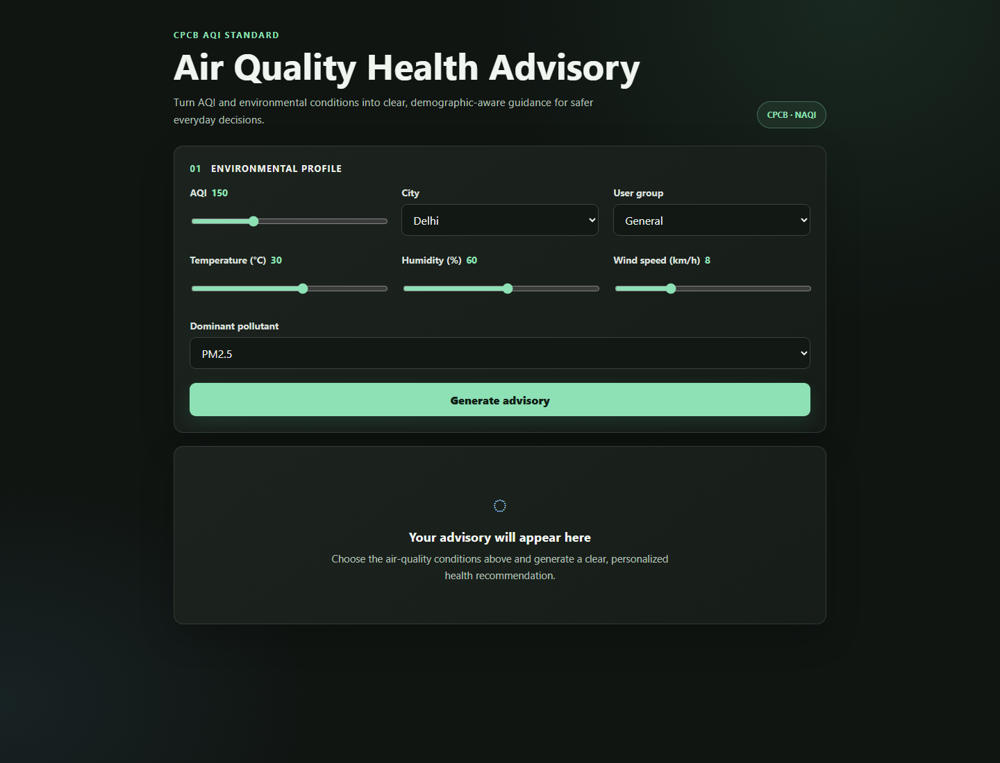
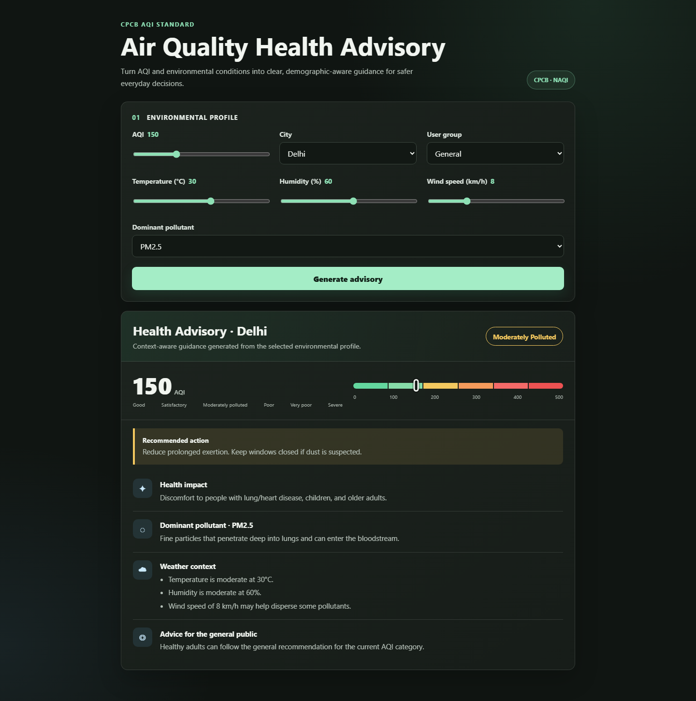

# Air Quality Health Advisory Generator

An air-quality analysis project that combines a CPCB-aligned advisory dashboard with data-processing and machine-learning experiments. The dashboard turns an AQI and user-selected environmental conditions into practical, group-specific guidance. The repository also includes scripts for dataset analysis, baseline classification, time-series forecasting, and rule-based advisory generation.

## Features

- **CPCB AQI categories:** Good, Satisfactory, Moderately Polluted, Poor, Very Poor, and Severe
- **Personalized guidance:** Recommendations for the general public, children, older adults, sensitive groups, and people with asthma
- **Environmental context:** Temperature, humidity, wind speed, and dominant-pollutant notes
- **Interactive dashboards:** A static website for hosting and a Streamlit dashboard for local Python use
- **Multi-city data support:** Indian cities plus Madrid and Beijing when data is available
- **Analysis pipeline:** Data cleaning, exploratory analysis, model comparison, and generated artifacts
- **Forecasting and advisory scripts:** Separate time-series and rule-based workflows

## Project Structure

```text
.
├── air_quality_pipeline.py          # Data preparation, analysis, and baseline ML pipeline
├── aqi_advisory_generator.py        # Rule-based advisory generation from source data
├── lstm_advisory_generator.py       # Time-series forecasting and advisory workflow
├── app/
│   └── dashboard.py                 # Streamlit dashboard for local use
├── public/
│   └── index.html                   # Static dashboard hosted by Vercel
├── configs/
│   └── cpcb_standards.yaml          # AQI, pollutant, and demographic reference values
├── data/
│   ├── raw/                         # Input datasets; excluded from Git
│   └── processed/                   # Generated datasets; excluded from Git
├── docs/
│   └── screenshots/                 # Dashboard screenshots used below
├── outputs/                         # Generated plots and analysis artifacts
├── .streamlit/
│   └── config.toml                  # Streamlit configuration
├── NLP Project final code.ipynb     # Notebook with project code and analysis
├── requirements.txt                 # Pinned dependencies for Python workflows
├── vercel.json                      # Static hosting output configuration
└── README.md
```

## Hosting and Access

The static dashboard entry point is `public/index.html`. The repository is configured for static hosting with Vercel; `vercel.json` sets `public` as the output directory. The page runs its advisory calculations in the visitor's browser and needs no Python server, database, API key, or model download.

**Public website:** Not published yet. No Vercel deployment has been created from this repository, so there is no live URL to list. Add the assigned `*.vercel.app` address here after the first deployment.

For the Vercel project settings, use the repository root, the **Other** framework preset, no build or install command, and `public` as the output directory. Import the GitHub repository as a new Vercel project. Subsequent pushes to its connected production branch will trigger redeployments.

The hosted static page is the advisory dashboard only. It does not run the Python data pipeline, train models, load local CSVs, or fetch live AQI readings. The Streamlit dashboard and research scripts remain separate local workflows.

## Screenshots

**Dashboard inputs** - choose the AQI, city, user group, weather conditions, and dominant pollutant.



**Generated advisory** - review the AQI category, recommended action, pollutant note, weather context, and group-specific advice.



## Run Locally

Run commands from the repository root.

### Static website

The static version needs only Python's built-in HTTP server; it has no package installation step.

```bash
python -m http.server 4173 --directory public
```

Open <http://localhost:4173>. Stop the server with `Ctrl+C`.

### Streamlit dashboard

Python 3.10 is recommended. Create a virtual environment and install the dashboard's direct dependencies:

```bash
python -m venv .venv
```

Windows PowerShell:

```powershell
.\.venv\Scripts\Activate.ps1
python -m pip install streamlit pandas
streamlit run app/dashboard.py
```

macOS or Linux:

```bash
source .venv/bin/activate
python -m pip install streamlit pandas
streamlit run app/dashboard.py
```

The dashboard opens at <http://localhost:8501>. If `data/processed/processed_dataset.csv` is present and has a `City` column, the Streamlit app uses it to populate the city selector. Otherwise, it uses its built-in city list.

### Full analysis environment

The complete pinned dependency set includes TensorFlow, PyTorch, Transformers, XGBoost, LightGBM, and the dashboard packages. Install it to run the research and ML workflows; it is larger than the minimal Streamlit setup.

```bash
python -m venv .venv
```

Activate the environment using the platform-specific command above, then install dependencies:

```bash
python -m pip install --upgrade pip
python -m pip install -r requirements.txt
```

Run the main pipeline or the separate advisory scripts from the repository root:

```bash
python air_quality_pipeline.py
python aqi_advisory_generator.py
python lstm_advisory_generator.py
```

The main pipeline reads datasets from `data/raw/`, writes generated datasets to `data/processed/`, and saves analysis outputs under `outputs/`. Raw and generated data are gitignored; add the required source CSVs locally before running the pipeline. The standalone advisory generator reports that no data was found when `data/raw/` is empty.

## Pipeline Steps

1. **Dataset understanding:** Inspect available city and country datasets.
2. **Data loading:** Load and combine supported source CSV files.
3. **Exploratory analysis:** Review descriptive statistics, missing values, and category balance.
4. **Visualization:** Generate distributions, box plots, and correlation heatmaps.
5. **Cleaning and preprocessing:** Impute missing values and prepare features without AQI-derived target leakage.
6. **Feature/target separation:** Keep target labels separate from the feature matrix.
7. **Train/test split:** Create a stratified split, handling rare categories where possible.
8. **Baseline models:** Train Logistic Regression, Decision Tree, Random Forest, XGBoost, and LightGBM when available.
9. **Evaluation:** Calculate accuracy, precision, recall, and F1 metrics.
10. **Error analysis:** Generate confusion matrices.
11. **Model comparison:** Rank models and save metrics, plots, and processed artifacts.

## Sample Advisory Output

```text
Delhi | AQI: 310 (Very Poor) | Group: Children
Air quality in Delhi is Very Poor (310 AQI). Respiratory illness on prolonged exposure; severe impact on sensitive groups. The dominant pollutant is PM2.5. Elevated humidity (75%) aggravates respiratory conditions. Children should limit outdoor activities and ensure proper ventilation indoors. Stay indoors with windows closed. Use air purifiers if available.
```

## Model Performance

The following scores are the results recorded for the baseline model comparison; rerunning the pipeline with different data may produce different results.

| Model | Accuracy | Precision | Recall | F1-Score |
|-------|----------|-----------|--------|----------|
| LightGBM | 89.88% | 89.77% | 89.88% | 89.75% |
| XGBoost | 89.81% | 89.70% | 89.81% | 89.64% |
| Random Forest | 87.66% | 88.45% | 87.66% | 87.84% |
| Logistic Regression | 79.37% | 84.65% | 79.37% | 80.21% |
| Decision Tree | 79.45% | 81.78% | 79.45% | 79.73% |

**Anti-overfitting measures:**

- Excluded AQI from model features when predicting `CPCB_Category`, since the category is derived from AQI.
- Added approximately 18% independent measurement noise where source pollutant values were deterministic AQI transforms.
- Used shallower trees, regularization, class balancing, and minimum leaf/split constraints.
- Recorded train/test accuracy gaps were approximately 0-3%; minority categories, especially Severe, remain harder to predict.

## Data Sources

- **CPCB Air Quality Data (2018):** Daily AQI and pollutant measurements for Indian cities.
- **Parameters:** AQI, PM2.5, PM10, NO2, SO2, CO, and O3.
- **Cities:** Bangalore, Chennai, Delhi, Hyderabad, and Mumbai; supplied international datasets may include Madrid and Beijing.
- Place supported source CSV files in `data/raw/` (gitignored); the project convention includes names such as `{City}_AQI_Dataset.csv`.
- Processed datasets are written to `data/processed/`; generated plots and reports are written to `outputs/`. Generated files are gitignored.
- The dashboards accept manual conditions and do not currently query live CPCB data or a weather service.

## Roadmap

- [ ] Validate and document forecasting metrics
- [ ] Build a synthetic advisory dataset and evaluate transformer-based text generation
- [ ] Integrate live AQI and weather data from supported sources
- [ ] Add automated tests and continuous integration
- [x] Streamlit dashboard for local use (`app/dashboard.py`)
- [x] Static browser dashboard prepared for Vercel hosting (`public/index.html`)

## License

MIT License - Feel free to use for research and education.

## Citation

If you use this project in research, replace the placeholder author with the appropriate author information before citing:

```bibtex
@misc{air-quality-advisory-2024,
	title={NLP-Based Air Quality Health Advisory Generator for India},
	author={Your Name},
	year={2024},
	note={CPCB NAQI Standards Compliant}
}
```
